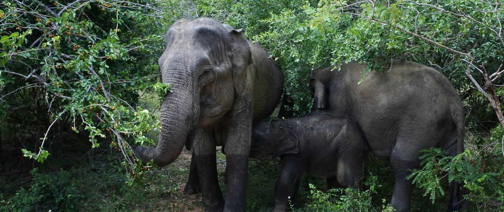

My research examines how human activities affect biodiversity and how effectively conservation measures mitigate these impacts, combining large-scale spatial data with quasi-experimental and statistical methods. In conjunction, I develop and evaluate acoustic and computational approaches for biodiversity monitoring.

```{=html}

```

## Protected areas and landscape ecology

Protected areas are central to global conservation policy, yet their effectiveness in reducing human pressure varies widely. My work focuses on quantifying human pressures on natural ecosystems and using quasi-experimental designs to estimate the extent to which protected areas, including the EU’s Natura 2000 network, mitigate these pressures. I have also explored how well remote-sensing indicators capture threats on the ground and how protected-area networks could be made more ecologically representative.

```{=html}
<div class="rstudies">
<article class="fs">
<h3>Riparian zones across the EU face continued threats from agriculture and urbanization, although pressures are lower within Natura 2000 sites.</h3>
<p>Across the EU, agriculture and urban areas covered 43% of riparian zones outside Natura 2000 sites, compared with 17% inside, with Natura 2000 protection more effective at limiting urbanization than agricultural encroachment.</p>
<a class="fs-link" href="https://doi.org/10.1016/j.biocon.2026.111856">Biological Conservation, 2026<i class="bi bi-box-arrow-up-right"></i></a>
</article>
<article class="fs">
<h3>Only 36 of 80 recently established protected areas in Southeast Asia were effective in reducing deforestation.</h3>
<p>We compared each protected area with a synthetic control built from unprotected forest and found that only 45% reduced deforestation. Investing at least US$17 million annually in improving the management of the remaining 44 could enhance their effectiveness in curbing forest loss and protecting carbon stocks, with carbon markets offering a potential source of funding.</p>
<a class="fs-link" href="https://doi.org/10.1016/j.cub.2024.07.031">Current Biology, 2024<i class="bi bi-box-arrow-up-right"></i></a>
</article>
<article class="fs">
<h3>Remote assessments of human pressure on biodiversity may miss important human threats.</h3>
<p>We compared three widely used indices of human pressure, including the Human Footprint, with threats recorded in Natura 2000 sites and found that they failed to capture threats such as hunting and invasive species. These findings highlight the need for researchers and practitioners to complement remote assessments with field-based information whenever possible.</p>
<a class="fs-link" href="https://doi.org/10.1002/inc3.11">Integrative Conservation, 2022<i class="bi bi-box-arrow-up-right"></i></a>
</article>
</div>
```

## Soundscape ecology

Passive acoustic monitoring allows vocalizing animals to be surveyed across large spatial and temporal scales. My work in this area focuses on evaluating and improving acoustic methods, including machine-learning approaches, for biodiversity monitoring.

```{=html}
<div class="rstudies">
<article class="fs">
<h3>Acoustic indices are only moderately correlated with biodiversity.</h3>
<p>We analysed 524 effect sizes from 49 studies and found a moderate positive correlation between acoustic indices and biodiversity (r = 0.32), which was stronger at higher latitudes. Acoustic indices may therefore underestimate diversity in the tropics, and the mechanisms behind this effect need further study.</p>
<a class="fs-link" href="https://doi.org/10.1016/j.ecolind.2024.111747">Ecological Indicators, 2024<i class="bi bi-box-arrow-up-right"></i></a>
</article>
<article class="fs">
<h3>Non-focal sounds confound the relationships between acoustic indices and bird species richness.</h3>
<p>We tested seven commonly used acoustic indices in southern China and found that sounds such as insects, wind and human noise influenced them more than bird species richness did. The indices were sensitive to the amount of bird sound rather than the number of species, which limits their use for monitoring bird diversity.</p>
<a class="fs-link" href="https://doi.org/10.1016/j.gecco.2024.e02922">Global Ecology and Conservation, 2024<i class="bi bi-box-arrow-up-right"></i></a>
</article>
<article class="fs">
<h3>A large ecoacoustic dataset from the Mediterranean Basin biodiversity hotspot.</h3>
<p>We made openly available more than 5,200 hours of recordings from 61 sites on Cyprus, through Hugging Face and the ARBIMON platform. Large datasets from biodiverse areas are needed to improve the accuracy of passive acoustic monitoring methods.</p>
<a class="fs-link" href="https://doi.org/10.1038/s41597-025-04807-1">Scientific Data, 2025<i class="bi bi-box-arrow-up-right"></i></a>
</article>
</div>
```

## Computational methods in ecology

I am interested in exploring how various computational tools, including large language models and conformal prediction, can advance ecological research, from synthesising scientific literature to quantifying uncertainty in machine-learning predictions.

```{=html}
<div class="rstudies">
<article class="fs">
<h3>Large language models have potentially transformative implications for ecology and conservation science.</h3>
<p>We synthesised emerging applications of large language models, described the associated challenges, and outlined potential ways to address them. Applied thoughtfully, these models can be a valuable addition to the ecologist’s toolkit, but they require prudent implementation to limit their risks.</p>
<a class="fs-link" href="https://doi.org/10.1111/cobi.70287">Conservation Biology, 2026<i class="bi bi-box-arrow-up-right"></i></a>
</article>
<article class="fs">
<h3>Large language models can facilitate interdisciplinary research, but carry important risks.</h3>
<p>We argued that LLMs can support interdisciplinary research by helping ecologists understand and adopt techniques common in other fields, but that they can generate inaccurate information when used for complex tasks. Journals should ensure that information and code generated with LLMs are validated, and academic programs should offer formal training in their use.</p>
<a class="fs-link" href="https://doi.org/10.1111/2041-210X.14398">Methods in Ecology and Evolution, 2024<i class="bi bi-box-arrow-up-right"></i></a>
</article>
<article class="fs">
<h3>Conformal prediction can quantify the uncertainty of machine learning models used to monitor animal communities.</h3>
<p>We showed how conformal prediction can add prediction intervals with guaranteed coverage to machine learning models, such as random forests, used to estimate bird species richness from acoustic data.</p>
<a class="fs-link" href="https://doi.org/10.1016/j.indic.2026.101387">Environmental and Sustainability Indicators, 2026<i class="bi bi-box-arrow-up-right"></i></a>
</article>
</div>
```

## Policy and society

My research also explores the broader social and policy context of conservation, including how biodiversity is represented in the media, how the EU allocates funding for conservation, and which species benefit most from its conservation efforts.

```{=html}
<div class="rstudies">
<article class="fs">
<h3>Media coverage of biodiversity falls short compared to climate change and popular culture.</h3>
<p>We analysed 227,940 media stories worldwide and found that COP27 received nearly seven times more coverage than COP15, which was also overshadowed by Taylor Swift. This was a missed opportunity to communicate the urgency of biodiversity action to the public and decision-makers.</p>
<a class="fs-link" href="https://doi.org/10.1038/s44185-025-00082-w">npj Biodiversity, 2025<i class="bi bi-box-arrow-up-right"></i></a>
</article>
<article class="fs">
<h3>EU conservation funding is unevenly distributed among habitats and member states.</h3>
<p>We analysed LIFE projects funded since 1992 and found that a quarter of habitats had never received funding and that transnational cooperation was low. The EU should encourage projects in underfunded member states, especially for habitats with an unfavourable conservation status, and promote transnational cooperation.</p>
<a class="fs-link" href="https://doi.org/10.1017/S0376892920000028">Environmental Conservation, 2020<i class="bi bi-box-arrow-up-right"></i></a>
</article>
<article class="fs">
<h3>The European Union’s conservation efforts are taxonomically biased.</h3>
<p>I argued that EU conservation efforts focus mostly on the species listed in the Birds and Habitats Directives, which over-represent vertebrates, especially birds.</p>
<a class="fs-link" href="https://doi.org/10.1007/s10531-019-01725-8">Biodiversity and Conservation, 2019<i class="bi bi-box-arrow-up-right"></i></a>
</article>
</div>
```

